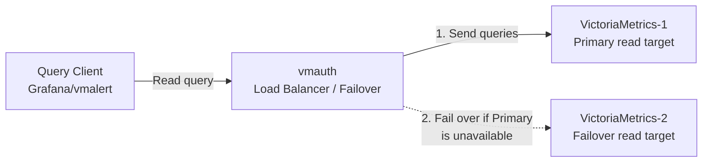
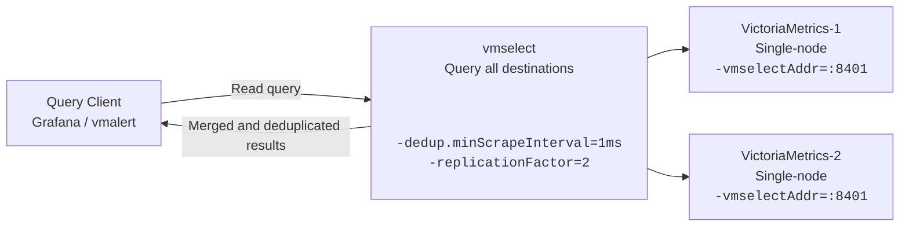

<!-- Part 7 of 13 of victoriametrics/README.md (split because the page is big). -->

## High availability

High availability with VictoriaMetrics single-nodes can be achieved by running multiple replicas of VictoriaMetrics, 
replicating writes to each replica, and load-balancing reads between them.

### High availability for writes

You can achieve **high availability for writes** via replication:

* Run two or more identically configured VictoriaMetrics instances (replicas), preferably in distinct datacenters (availability zones);
* Replicate writes simultaneously into all these instances via one or multiple [vmagents](https://docs.victoriametrics.com/victoriametrics/vmagent/) (or other agents that support replication).

For example, configure vmagent [to replicate data](https://docs.victoriametrics.com/victoriametrics/vmagent/#replication-and-high-availability)
to multiple remote destinations by specifying multiple `-remoteWrite.url` flags:
```sh
/path/to/vmagent \
  -remoteWrite.url=https://victoriametrics-1:8428/api/v1/write \
  -remoteWrite.url=https://victoriametrics-2:8428/api/v1/write
```

Each `--remoteWrite.url` creates its own replication queue. The queue temporarily stores data on disk while the remote destination is unavailable.
See more about [on-disk persistence in vmagent](https://docs.victoriametrics.com/victoriametrics/vmagent/#on-disk-persistence).

When the remote destination becomes available again, vmagent re-reads the queue and pushes unsent data, restoring data consistency across destinations.

> The max size of the on-disk queue can be increased by [horizontally sharding vmagents](https://docs.victoriametrics.com/victoriametrics/vmagent/#scraping-big-number-of-targets).
> To achieve high availability for vmagent itself, run multiple identically configured vmagent replicas.
> In this case, the load on the remote destinations will increase proportionally to the number of vmagent replicas. The duplicated data in remote destinations
> has to be [deduplicated](https://docs.victoriametrics.com/victoriametrics/#deduplication) on the VictoriaMetrics side.

### High availability for reads

For achieving high availability for reads, make sure that you already achieved [high availability for writes](https://docs.victoriametrics.com/victoriametrics/#high-availability-for-writes), so all VictoriaMetrics replicas contain the same data.

You can achieve **high availability for reads** by choosing one of the following options:

- [Load balance read requests among replicas](https://docs.victoriametrics.com/victoriametrics/#load-balance-read-requests-among-replicas): use a load balancer to route read requests to an available VictoriaMetrics instance.
- [Query multiple replicas via vmselect](https://docs.victoriametrics.com/victoriametrics/#query-multiple-replicas-via-vmselect): use vmselect to query all available VictoriaMetrics instances and merge their results.

#### Load balance read requests among replicas

Use [vmauth to load-balance](https://docs.victoriametrics.com/vmauth/#load-balancing) read queries among available VictoriaMetrics replicas
and re-route requests away from unavailable replicas:
```
unauthorized_user:
  url_prefix:
  - http://victoria-metrics-1:8428/
  - http://victoria-metrics-2:8428/
```

With this configuration, vmauth will uniformly share load among the replicas using the least-loaded round-robin policy. But if you run VictoriaMetrics replicas in different geographically distributed availability zones, you might want to prefer the closest replica for all requests until it fails. This can be achieved by [changing vmauth load-balancing policy to `first_available`](https://docs.victoriametrics.com/vmauth/#high-availability), so all requests will land on preferred replica and will get re-routed only if it becomes unavailable:



Load-balancing is **the most cost-efficient option** - it queries only one VictoriaMetrics instance at a time. If any instance fails to respond, vmauth will transparently re-route requests to the next available instance.

The downside of this approach is that when one instance goes down and then comes back, the load balancer may start routing read queries to it again. Even though this instance didn't catch up yet with vmagent's queue and may return incomplete results.

This shortcoming can be mitigated by removing the catching-up instance from the vmauth configuration until the vmagent queues are drained. If using [Kubernetes VMDistributed](https://docs.victoriametrics.com/operator/resources/vmdistributed/) resource, this mechanism is automatically applied during orchestrated updates.

Another option is to use to [query all replicas at once](https://docs.victoriametrics.com/victoriametrics/#query-multiple-replicas-via-vmselect), as described below.

#### Query multiple replicas via vmselect

In this option, we use a top-level [vmselect](https://docs.victoriametrics.com/victoriametrics/cluster-victoriametrics/#architecture-overview) to query all
remote destinations simultaneously and merge the results.

This option is only possible if VictoriaMetrics single-node instances are configured with the `-vmselectAddr` flag.
See how to configure vmselect for [reading from single-node VictoriaMetrics](https://docs.victoriametrics.com/victoriametrics/cluster-victoriametrics/#reading-from-single-node-victoriametrics).



This option **requires extra resources** on vmselect because it queries all remote destinations simultaneously and merges
their responses before returning the final result.

The benefit is that it can handle data gaps across destinations by merging responses from all VictoriaMetrics instances (as long as at least one instance has all the data without gaps).
Thus, a single recovering instance can't cause incomplete results, as gaps will be filled with samples from the healthy replica.

Since vmselect fetches replicated data from VictoriaMetrics instances, it must be [deduplicated](https://docs.victoriametrics.com/victoriametrics/cluster-victoriametrics/#deduplication) before processing.
Configure vmselect with `-dedup.minScrapeInterval=1ms` to remove duplicated samples during merging.
Also set `-replicationFactor=N` on vmselect, where `N` equals the number of remote storage destinations, so that queries
can tolerate the unavailability of up to `N-1` destinations.


## Deduplication

VictoriaMetrics leaves a single [raw sample](https://docs.victoriametrics.com/victoriametrics/keyconcepts/#raw-samples)
with the biggest [timestamp](https://en.wikipedia.org/wiki/Unix_time) for each [time series](https://docs.victoriametrics.com/victoriametrics/keyconcepts/#time-series)
per each `-dedup.minScrapeInterval` discrete interval if `-dedup.minScrapeInterval` is set to positive duration.
For example, `-dedup.minScrapeInterval=60s` would leave a single raw sample with the biggest timestamp per each discrete
`60s` interval.
This aligns with the [staleness rules in Prometheus](https://prometheus.io/docs/prometheus/latest/querying/basics/#staleness).

If multiple raw samples have **the same timestamp** on the given `-dedup.minScrapeInterval` discrete interval,
then the sample with **the biggest value** is kept.
Numerical values are preferred over [stale markers](https://docs.victoriametrics.com/victoriametrics/vmagent/#prometheus-staleness-markers).

Please note, [labels](https://docs.victoriametrics.com/victoriametrics/keyconcepts/#labels) of raw samples should be identical
in order to be deduplicated. For example, this is why [HA pair of vmagents](https://docs.victoriametrics.com/victoriametrics/vmagent/#high-availability)
needs to be identically configured.

The `-dedup.minScrapeInterval=D` is equivalent to `-downsampling.period=0s:D` in [downsampling](#downsampling).
It is also safe to use deduplication and downsampling simultaneously.

The recommended value for `-dedup.minScrapeInterval` must equal to `scrape_interval` config from Prometheus configs.
It is recommended to have a single `scrape_interval` across all the scrape targets.
See [this article](https://www.robustperception.io/keep-it-simple-scrape_interval-id) for details.

The de-duplication reduces disk space usage if multiple **identically configured** [vmagent](https://docs.victoriametrics.com/victoriametrics/vmagent/)
or Prometheus instances in HA pair write data to the same VictoriaMetrics instance.
These vmagent or Prometheus instances must have **identical** `external_labels` section in their configs,
so they write data to the same time series.
See also [how to set up multiple vmagent instances for scraping the same targets](https://docs.victoriametrics.com/victoriametrics/vmagent/#scraping-big-number-of-targets).
Note that de-duplication doesn't reduce the [`indexdb`](https://docs.victoriametrics.com/victoriametrics/single-server-victoriametrics/#indexdb) size -
see [why IndexDB size is so large?](https://docs.victoriametrics.com/victoriametrics/faq/#why-indexdb-size-is-so-large).

It is recommended passing different `-promscrape.cluster.name` values to each distinct HA pair of `vmagent` instances,
so the de-duplication consistently leaves samples for one `vmagent` instance and removes duplicate samples
from other `vmagent` instances.
See [these docs](https://docs.victoriametrics.com/victoriametrics/vmagent/#high-availability) for details.

VictoriaMetrics stores all the ingested samples to disk even if `-dedup.minScrapeInterval` command-line flag is set.
The ingested samples are de-duplicated during [background merges](#storage) and during query execution.
VictoriaMetrics also supports de-duplication during data ingestion before the data is stored to disk, via `-streamAggr.dedupInterval` command-line flag -
see [these docs](https://docs.victoriametrics.com/victoriametrics/stream-aggregation/#deduplication).


## Metrics Metadata

Single-node VictoriaMetrics can store metric metadata (`TYPE`, `HELP`, `UNIT`) {}.
Metadata ingestion and querying are enabled by default{}. To disable them, set `-enableMetadata=false`.

The metadata is cached in-memory in a ring buffer and can use up to 1% of available memory by default (see `-storage.maxMetadataStorageSize` cmd-line flag).
When in-memory size is exceeded, the least updated entries are dropped first. Entries that weren't updated for 1h are cleaned up automatically.

> The following expression helps to understand if metadata cache capacity is utilized for more than 90%: `vm_metrics_metadata_storage_size_bytes / vm_metrics_metadata_storage_max_size_bytes > 0.9`.
Setup [monitoring](https://docs.victoriametrics.com/victoriametrics/quick-start/#monitoring) and recommended alerting rules
to get notified about cache capacity issues.

Metadata is ingested independently from metrics, so a metric can exist without metadata, and vice versa.
Metadata is expected to be ephemeral and constantly updated on ingestion. For this reason, metadata cache isn't 
persisted during restarts.

Metadata can be queried via the `/api/v1/metadata` endpoint, which provides a response compatible with the Prometheus [metadata API](https://prometheus.io/docs/prometheus/latest/querying/api/#querying-metric-metadata).
See [/api/v1/metadata](https://docs.victoriametrics.com/victoriametrics/url-examples/#apiv1metadata) example.


## Storage

VictoriaMetrics buffers the ingested data in memory for up to a second. Then the buffered data is written to in-memory `parts`,
which can be searched during queries. The in-memory `parts` are periodically persisted to disk, so they could survive unclean shutdown
such as out of memory crash, hardware power loss or `SIGKILL` signal. The interval for flushing the in-memory data to disk
can be configured with the `-inmemoryDataFlushInterval` command-line flag (note that too short flush interval may significantly increase disk IO).

In-memory parts are persisted to disk into `part` directories under the `<-storageDataPath>/data/small/YYYY_MM/` folder,
where `YYYY_MM` is the month partition for the stored data. For example, `2022_11` is the partition for `parts`
with [raw samples](https://docs.victoriametrics.com/victoriametrics/keyconcepts/#raw-samples) from `November 2022`.
Each partition directory contains `parts.json` file with the actual list of parts in the partition.

Every `part` directory contains `metadata.json` file with the following fields:

* `RowsCount` - the number of [raw samples](https://docs.victoriametrics.com/victoriametrics/keyconcepts/#raw-samples) stored in the part
* `BlocksCount` - the number of blocks stored in the part (see details about blocks below)
* `MinTimestamp` and `MaxTimestamp` - minimum and maximum timestamps across raw samples stored in the part
* `MinDedupInterval` - the [deduplication interval](#deduplication) applied to the given part.

Each `part` consists of `blocks` sorted by internal time series id (aka `TSID`).
Each `block` contains up to 8K [raw samples](https://docs.victoriametrics.com/victoriametrics/keyconcepts/#raw-samples),
which belong to a single [time series](https://docs.victoriametrics.com/victoriametrics/keyconcepts/#time-series).
Raw samples in each block are sorted by `timestamp`. Blocks for the same time series are sorted
by the `timestamp` of the first sample. Timestamps and values for all the blocks
are stored in [compressed form](https://faun.pub/victoriametrics-achieving-better-compression-for-time-series-data-than-gorilla-317bc1f95932)
in separate files under `part` directory - `timestamps.bin` and `values.bin`.

The `part` directory also contains `index.bin` and `metaindex.bin` files - these files contain index
for fast block lookups, which belong to the given `TSID` and cover the given time range.

`Parts` are periodically merged into bigger parts in background. The background merge provides the following benefits:

* keeping the number of data files under control, so they don't exceed limits on open files
* improved data compression, since bigger parts are usually compressed better than smaller parts
* improved query speed, since queries over smaller number of parts are executed faster
* various background maintenance tasks such as [de-duplication](#deduplication), [downsampling](#downsampling)
  and [freeing up disk space for the deleted time series](#how-to-delete-time-series) are performed during the merge

See how `vmstorage` [selects parts for background merging](https://victoriametrics.com/blog/vmstorage-retention-merging-deduplication/#merge-process),
including merge limits and monitoring metrics.

Newly added `parts` either successfully appear in the storage or fail to appear.
The newly added `part` is atomically registered in the `parts.json` file under the corresponding partition
after it is fully written and [fsynced](https://man7.org/linux/man-pages/man2/fsync.2.html) to the storage.
Thanks to this algorithm, storage never contains partially created parts, even if hardware power off
occurs in the middle of writing the `part` to disk - such incompletely written `parts`
are automatically deleted on the next VictoriaMetrics start. 
The same applies to merge process — `parts` are either fully merged into a new `part` or fail to merge,
leaving the source `parts` untouched. 

Hardware issues may cause data already stored on disk to become corrupted, regardless of the VictoriaMetrics process.
VictoriaMetrics can detect corruption during reading, decompressing, decoding or sanity checking of the data blocks. 
Process will intentionally panic when this happens, so human operator can detect corruption as fast as possible. 

> VictoriaMetrics cannot fix the corrupted data parts on its own.
> Data parts that fail to load on startup or during reads need to be deleted or restored from backups. 
> It is recommended performing [regular backups](https://docs.victoriametrics.com/victoriametrics/cluster-victoriametrics/#backups).

VictoriaMetrics doesn't use checksums for stored data blocks. See why in this [GitHub Issue](https://github.com/VictoriaMetrics/VictoriaMetrics/issues/3011).

VictoriaMetrics does not merge parts if their combined size exceeds the available free disk space. This behavior 
protects against potential "out of disk space" errors during merges. If there is not enough free disk space to perform merges, 
the number of parts may increase significantly over time. This increases query overhead, because VictoriaMetrics must 
read data from a larger number of parts for each request.

> It is recommended to keep at least 20% of disk space free in the directory specified by the `-storageDataPath` command-line flag.

Information about merging process is available in [the dashboard for single-node VictoriaMetrics](https://grafana.com/grafana/dashboards/10229)
and [the dashboard for VictoriaMetrics cluster](https://grafana.com/grafana/dashboards/11176).
See more details in [monitoring docs](#monitoring).

See [this article](https://valyala.medium.com/how-victoriametrics-makes-instant-snapshots-for-multi-terabyte-time-series-data-e1f3fb0e0282) for more details.

See also [how to work with snapshots](#how-to-work-with-snapshots) and [IndexDB](#indexdb).
