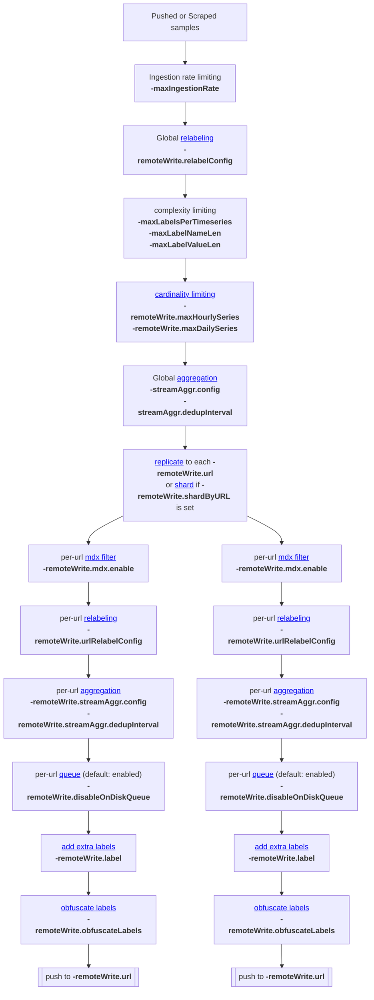

<!-- Part 2 of 8 of victoriametrics/vmagent.md (split because the page is big). -->

## Use Cases

### IoT and Edge monitoring

`vmagent` can run and collect metrics in IoT environments and industrial networks with unreliable or scheduled connections to remote storage.
It buffers the collected data in local files until the connection to remote storage becomes available and then sends the buffered
data to the remote storage. It retries sending the data to remote storage until errors are resolved.
The maximum on-disk size for the buffered metrics can be limited with `-remoteWrite.maxDiskUsagePerURL`.

`vmagent` supports several common architectures used in IoT environments: 32-bit ARM, 64-bit ARM, PPC64, 386, and AMD64.

`vmagent` can reduce network bandwidth costs by using the [VictoriaMetrics remote write protocol](#victoriametrics-remote-write-protocol).

See [how to optimize index size at VictoriaMetrics for IoT and industrial monitoring](https://docs.victoriametrics.com/victoriametrics/single-server-victoriametrics/#index-tuning-for-low-churn-rate).

### Drop-in replacement for Prometheus

If you use Prometheus only for scraping metrics from various targets and forwarding these metrics to remote storage,
then `vmagent` can replace Prometheus. Typically, `vmagent` requires less RAM, CPU, and network bandwidth than Prometheus.
See [these docs](#how-to-collect-metrics-in-prometheus-format) for details.

### Statsd alternative

`vmagent` can be used as an alternative to [StatsD](https://github.com/statsd/statsd)
when [stream aggregation](https://docs.victoriametrics.com/victoriametrics/stream-aggregation/) is enabled.
See [these docs](https://docs.victoriametrics.com/victoriametrics/stream-aggregation/#statsd-alternative) for details.

### Flexible metrics relay

`vmagent` can accept metrics in [various popular data ingestion protocols](#how-to-push-data-to-vmagent), apply [relabeling](https://docs.victoriametrics.com/victoriametrics/relabeling/)
to the accepted metrics (for example, change metric names/labels or drop unneeded metrics) and then forward the relabeled metrics
to other remote storage systems that support Prometheus `remote_write` protocol (including other `vmagent` instances).

### Replication and high availability

`vmagent` replicates the collected metrics among multiple remote storage instances configured via `-remoteWrite.url` args.
If a single remote storage instance is temporarily unavailable, the collected data remains available on the other remote storage instances.
`vmagent` buffers the collected data in files at `-remoteWrite.tmpDataPath` until the remote storage becomes available again.
Then it sends the buffered data to the remote storage in order to prevent data gaps.
See how `vmagent` [selects shards and places replicas](https://victoriametrics.com/blog/vmagent-how-it-works/#step-4-sharding--replication) for implementation details.

[VictoriaMetrics cluster](https://docs.victoriametrics.com/victoriametrics/cluster-victoriametrics/) already supports replication,
so there is no need to specify multiple `-remoteWrite.url` flags when writing data to the same cluster.
See [these docs](https://docs.victoriametrics.com/victoriametrics/cluster-victoriametrics/#replication-and-data-safety).

### Relabeling and filtering

`vmagent` can add, remove, or update labels on the collected data before sending it to the remote storage.
It can filter scrape targets or remove unwanted samples via Prometheus-like relabeling.
Please see the [Relabeling cookbook](https://docs.victoriametrics.com/victoriametrics/relabeling/) for configuration examples.
For ingestion pipeline internals, see how `vmagent` [applies global relabeling and cardinality limits](https://victoriametrics.com/blog/vmagent-how-it-works/#step-2-global-relabeling-cardinality-reduction).

### Sharding among remote storages

By default, `vmagent` replicates data to remote storage systems via the `-remoteWrite.url` command-line flag.
If the `-remoteWrite.shardByURL` command-line flag is set, then `vmagent` spreads
the outgoing [time series](https://docs.victoriametrics.com/victoriametrics/keyconcepts/#time-series) evenly among all the remote storage
systems listed in `-remoteWrite.url`.

It is possible to replicate samples among remote storage systems by passing `-remoteWrite.shardByURLReplicas=N`
to `vmagent` in addition to the `-remoteWrite.shardByURL` command-line flag.
This instructs `vmagent` to write every outgoing sample to `N` number of distinct remote storage systems listed in `-remoteWrite.url`
in addition to sharding.

Samples for the same time series are routed to the same remote storage system if the `-remoteWrite.shardByURL` flag is specified.
This allows building scalable data processing pipelines when a single remote storage cannot keep up with the data ingestion workload.
For example, this allows horizontal scaling with [stream aggregation](https://docs.victoriametrics.com/victoriametrics/stream-aggregation/)
by routing outgoing samples for the same time series like [counter](https://docs.victoriametrics.com/victoriametrics/keyconcepts/#counter)
and [histogram](https://docs.victoriametrics.com/victoriametrics/keyconcepts/#histogram) types from top-level `vmagent` instances
to the same second-level `vmagent` instance, so they are aggregated properly.

> The `-remoteWrite.shardByURL` may not work as expected when [SRV URLs](https://docs.victoriametrics.com/victoriametrics/vmagent/#srv-urls) are in use.
>
> An SRV record might resolve to multiple addresses; one address is chosen **randomly** for all subsequent logic, including sharding.
> It will make sharding inconsistent. Samples from the same time series always go to the same **remote write URL**/**SRV record**, but they may reach different addresses at random due to DNS resolution.
>
> For example, if you set `-remoteWrite.url=srv+foo` and it's resolved to three addresses (`192.168.1.1`, `192.168.1.2`, `192.168.1.3`),
> vmagent will only choose **one** randomly every time it (re-)creates the connection. In contrast, specifying the addresses manually (`-remoteWrite.url=192.168.1.1 -remoteWrite.url=192.168.1.2 -remoteWrite.url=192.168.1.3`) will shard samples across all three URLs.

If the `-remoteWrite.shardByURL` command-line flag is set, `vmagent` defaults to using all the metric labels for even sharding
among remote storage systems specified in `-remoteWrite.url`.

Use `-remoteWrite.shardByURL.labels` to route metrics among `-remoteWrite.url` based on their label values.
For example, `-remoteWrite.shardByURL.labels=instance,__name__` would shard metrics with the same name and `instance`
label to the same `-remoteWrite.url`. This command-line flag allows specifying a comma-separated list of labels.

Alternatively, you can use `-remoteWrite.shardByURL.ignoreLabels` to route metrics among `-remoteWrite.url` based on their label values, excluding the specified labels.
For example, `-remoteWrite.shardByURL.ignoreLabels=pod` would shard metrics `metric{pod="foo"}` and `metric{pod="bar"}` to the same `-remoteWrite.url`
by ignoring the `pod` label. This command-line flag allows specifying a comma-separated list of labels.

> Command-line flags `-remoteWrite.shardByURL.labels` and `-remoteWrite.shardByURL.ignoreLabels` are mutually exclusive.

See also [how to scrape a large number of targets](#scraping-big-number-of-targets).

### Splitting data streams among multiple systems

`vmagent` supports splitting the collected data between multiple destinations with the help of `-remoteWrite.urlRelabelConfig`,
it is applied independently for each configured `-remoteWrite.url` destination. For example, it is possible to replicate or split
data among long-term remote storage, short-term remote storage, and a real-time analytical system [built on top of Kafka](https://github.com/Telefonica/prometheus-kafka-adapter).
Note that each destination can receive its own subset of the collected data due to per-destination relabeling via `-remoteWrite.urlRelabelConfig`.

For example, let's assume that all the metrics scraped or received by `vmagent` have the label `env` with the value of `dev` or `prod`.
To route metrics with the label `env=dev` to `dev` and metrics with the label `env=prod` to `prod` apply the following config:

1. Create a relabeling config file `relabelDev.yml` to drop all metrics that don't have the label `env=dev`:

```yaml
- action: keep
  source_labels: [env]
  regex: "dev"
```

2. Create a relabeling config file `relabelProd.yml` to drop all metrics that don't have the label `env=prod`:

```yaml
- action: keep
  source_labels: [env]
  regex: "prod"
```

3. Configure `vmagent` with 2 `-remoteWrite.url` flags pointing to destinations `dev` and `prod` with corresponding
`-remoteWrite.urlRelabelConfig` config files:

```sh
./vmagent \
  -remoteWrite.url=http://<dev-url> -remoteWrite.urlRelabelConfig=relabelDev.yml \
  -remoteWrite.url=http://<prod-url> -remoteWrite.urlRelabelConfig=relabelProd.yml
```

With this configuration, `vmagent` will only forward metrics with the label `env=dev` to `http://<dev-url>` and
metrics with the label `env=prod` to `http://<prod-url>`.

Please note, the order of flags is important: the first `-remoteWrite.urlRelabelConfig` will be applied to the
first `-remoteWrite.url`, and so on.

### Prometheus remote_write proxy

`vmagent` can be used as a proxy for Prometheus data sent via Prometheus `remote_write` protocol. It can accept data via the `remote_write` API
at the`/api/v1/write` endpoint. It then applies relabeling and filtering; then proxies it to another `remote_write` system.
`vmagent` can also be configured to encrypt the incoming `remote_write` requests with `-tls*` command-line flags.
Basic Auth can be enabled for incoming `remote_write` requests using the `-httpAuth.*` command-line flags.

### remote_write for clustered version

While `vmagent` can accept data in several supported protocols (OpenTSDB, Influx, Prometheus, Graphite) and scrape data from various targets,
writes are always performed using the Prometheus remote_write protocol. Therefore, for the [clustered version](https://docs.victoriametrics.com/victoriametrics/cluster-victoriametrics/),
the `-remoteWrite.url` command-line flag should be configured as `<schema>://<vminsert-host>:8480/insert/<accountID>/prometheus/api/v1/write`
according to [these docs](https://docs.victoriametrics.com/victoriametrics/cluster-victoriametrics/#url-format).
There is also support for multitenant writes. See [these docs](#multitenancy).

### Flexible deduplication

[Deduplication at stream aggregation](https://docs.victoriametrics.com/victoriametrics/stream-aggregation/#deduplication) allows setting up arbitrary complex deduplication schemes
for the collected samples. Examples:

* The following command instructs `vmagent` to send only the last sample for each
[time series](https://docs.victoriametrics.com/victoriametrics/keyconcepts/#time-series) every 60 seconds:

  ```sh
  ./vmagent -remoteWrite.url=http://remote-storage/api/v1/write -streamAggr.dedupInterval=60s
  ```

* The following command instructs `vmagent` to merge [time series](https://docs.victoriametrics.com/victoriametrics/keyconcepts/#time-series) with different `replica` label values
  and then to send only the last sample for each merged series every 60 seconds:

  ```sh
  ./vmagent -remoteWrite.url=http://remote-storage/api/v1/write -streamAggr.dropInputLabels=replica -streamAggr.dedupInterval=60s
  ```

See how `vmagent` [orders global deduplication and stream aggregation](https://victoriametrics.com/blog/vmagent-how-it-works/#step-3-global-deduplication--stream-aggregation) in the ingestion pipeline.

### Monitoring Data eXchange

The Monitoring Data eXchange (MDX){} feature allows `vmagent` to forward only VictoriaMetrics metrics to selected `-remoteWrite.url` destinations while dropping metrics from non-VictoriaMetrics services.

To enable MDX, set `-remoteWrite.mdx.enable=true` for the target URL and `-remoteWrite.mdx.enable=false` for other URLs:

```sh
./vmagent \
  -remoteWrite.url=http://service-to-keep-all-metrics:8428/api/v1/write \
  -remoteWrite.mdx.enable=false \
  -remoteWrite.url=http://service-to-keep-only-vm-metrics:8428/api/v1/write \
  -remoteWrite.mdx.enable=true
```
When MDX is enabled for a `-remoteWrite.url`, `vmagent` forwards only metrics that:
- come from the target that exposes the `vm_app_version` metric (emitted by all VictoriaMetrics components)
- contain the `victoriametrics_app=true` label, which will be added automatically to the metrics if the instance was deployed via [VictoriaMetrics Operator](https://docs.victoriametrics.com/operator/).

`victoriametrics_app=true` label will be added to all metrics that are preserved by MDX if it's absent.

- contain the label specified via `-mdx.label`.

```sh
./vmagent \
  -remoteWrite.url=http://service-to-keep-only-vm-metrics:8428/api/v1/write \
  -remoteWrite.mdx.enable=true \
  -mdx.label="service=victoriametrics"
```
In this configuration, metrics with the label `service=victoriametrics` are preserved even if their scrape targets do not expose `vm_app_version` metric.

The number of VictoriaMetrics metrics preserved by MDX is exposed as `vmagent_remotewrite_mdx_rows_preserved_total`.

The scope of MDX is at the per-url level, so it works after global level mechanisms, such as stream aggregation, relabeling, complexity limiter, and cardinality limiter. See [Life of a sample](https://docs.victoriametrics.com/victoriametrics/vmagent/#life-of-a-sample).

`vmagent` disables [metrics metadata](https://docs.victoriametrics.com/victoriametrics/vmagent/#metric-metadata) sending for MDX remote write URL,
because VictoriaMetrics services don't expose metadata, and metadata isn't filtered by MDX and may include entries for non-VictoriaMetrics metrics.

### Life of a sample

vmagent supports limiting, relabeling, deduplication, and stream aggregation for all metric samples, scraped or pushed.
The received data is then forwarded to the specified `-remoteWrite.url` destinations. The pipeline is as follows:



Scraping has additional settings that can be applied before samples are pushed to the processing pipeline above:
1. [Service Discovery relabeling](https://docs.victoriametrics.com/victoriametrics/relabeling/#service-discovery-relabeling)
2. [Scraping relabeling](https://docs.victoriametrics.com/victoriametrics/relabeling/#scraping-relabeling)
3. `sample_limit`, `series_limit`, `label_limit` in [scrape_configs](https://docs.victoriametrics.com/victoriametrics/sd_configs/#scrape_configs).
