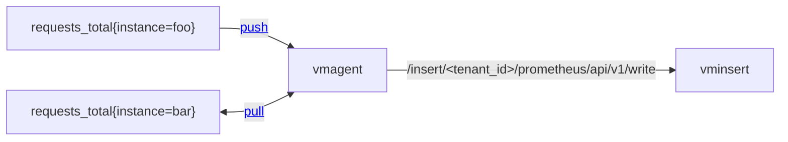
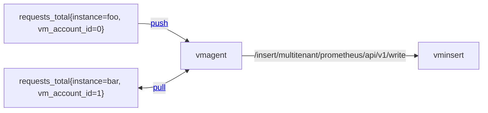
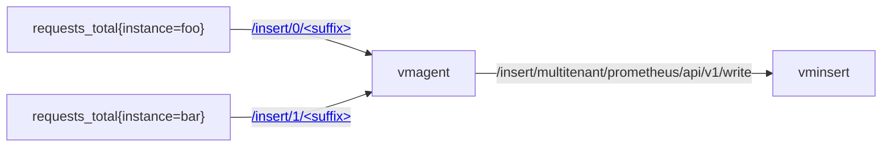
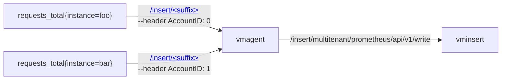

<!-- Part 4 of 8 of victoriametrics/vmagent.md (split because the page is big). -->

## Multitenancy

By default, `vmagent` collects the data without [tenant](https://docs.victoriametrics.com/victoriametrics/cluster-victoriametrics/#multitenancy) identifiers
and routes it to the remote storage specified via `-remoteWrite.url` command-line flag. Point `-remoteWrite.url` to vminsert's `/insert/<tenant_id>/prometheus/api/v1/write` path
according to [these docs](https://docs.victoriametrics.com/victoriametrics/cluster-victoriametrics/#url-format). 

> Note: the single-node version of VictoriaMetrics doesn't support multitenancy.



In this case, all the metrics written to `/insert/<tenant_id>/prometheus/api/v1/write` will belong to the specified `<tenant_id>` tenant.

### Multitenancy via labels

vmagent can write data to **multiple distinct tenants** if `-remoteWrite.url` points to the [multitenant URL in the VictoriaMetrics cluster](https://docs.victoriametrics.com/victoriametrics/cluster-victoriametrics/#multitenancy-via-labels)
and the tenant is specified via [multitenancy labels](https://docs.victoriametrics.com/victoriametrics/cluster-victoriametrics/#multitenancy-via-labels):



> A single payload pulled from or pushed to vmagent may contain time series belonging to multiple tenants.

When vminsert receives the data on the `/insert/multitenant` path, it extracts `<tenant_id>` from the `vm_account_id` and `vm_project_id` labels for
each distinct time series.

> If `vm_account_id` or `vm_project_id` labels are missing or invalid, then the corresponding accountID and projectID are set to 0.

The `vm_account_id` and `vm_project_id` labels can be specified via [relabeling](https://docs.victoriametrics.com/victoriametrics/relabeling/) before sending the metrics to `-remoteWrite.url`.
For example, the following relabeling rule instructs sending metrics to `<account_id>:0` tenant defined in the `prometheus.io/account_id` annotation of Kubernetes pod deployment:
```yaml
scrape_configs:
- kubernetes_sd_configs:
  - role: pod
  relabel_configs:
  - source_labels: [__meta_kubernetes_pod_annotation_prometheus_io_account_id]
    target_label: vm_account_id
```

vmagent can get the tenant identifier from the `__tenant_id__` label during the target discovery phase.
It implicitly converts the `__tenant_id__` label into `vm_account_id` and `vm_project_id` labels and attaches
them to the scraped metrics and metrics metadata.

For example, the following relabeling rule instructs sending metrics to the `10:5` tenant defined in the `prometheus.io/tenant_id: 10:5`
annotation of the Kubernetes pod deployment:

```yaml
scrape_configs:
- kubernetes_sd_configs:
  - role: pod
  relabel_configs:
  - source_labels: [__meta_kubernetes_pod_annotation_prometheus_io_tenant_id]
    target_label: __tenant_id__
```

vmagent can also [enforce adding labels](https://docs.victoriametrics.com/victoriametrics/vmagent/#adding-labels-to-metrics)
on all scraped or forwarded metrics. 

### Multitenancy via path

vmagent can write data to multiple distinct tenants if:
* its `-remoteWrite.url` points to the [VictoriaMetrics cluster multitenant URL](https://docs.victoriametrics.com/victoriametrics/cluster-victoriametrics/#multitenancy-via-labels)
* its `-enableMultitenantHandlers` command-line flag is set
* clients ingest data into vmagent with the tenant specified in the [write path](https://docs.victoriametrics.com/victoriametrics/cluster-victoriametrics/#url-format)



In this configuration, vmagent accepts writes via the same multitenant endpoints (`/insert/<accountID>/<suffix>`) [as vminsert does](https://docs.victoriametrics.com/victoriametrics/cluster-victoriametrics/#url-format).
For all the received data, vmagent will automatically convert tenant identifiers in the URL path to `vm_account_id` and `vm_project_id` labels, and set tenant information in metadata.

These tenant labels are added before applying [relabeling](https://docs.victoriametrics.com/victoriametrics/relabeling/)
specified via `-remoteWrite.relabelConfig` and `-remoteWrite.urlRelabelConfig` command-line flags. 

### Multitenancy via headers

vmagent can write data to multiple distinct tenants if:
* its `-remoteWrite.url` points to the [VictoriaMetrics cluster multitenant URL](https://docs.victoriametrics.com/victoriametrics/cluster-victoriametrics/#multitenancy-via-labels)
* its `-enableMultitenantHandlers` and `-enableMultitenancyViaHeaders` (enabled by default {}) command-line flags are both set
* clients ingest data into vmagent with the tenants specified [via headers](https://docs.victoriametrics.com/victoriametrics/cluster-victoriametrics/#multitenancy-via-headers) {}



In this configuration, vmagent accepts writes via the same simplified multitenant endpoints (`/insert/<suffix>`) [as vminsert does](https://docs.victoriametrics.com/victoriametrics/cluster-victoriametrics/#url-format).
The tenant information is extracted from the `AccountID` and `ProjectID` HTTP headers, which are expected to be included in all incoming requests.

> If headers are missing, then the tenant is set to `0:0` by default.

For all the received data, vmagent will automatically convert tenant identifiers in the headers to `vm_account_id` and `vm_project_id` labels, and set tenant info in metadata.
These tenant labels are added before applying [relabeling](https://docs.victoriametrics.com/victoriametrics/relabeling/) specified via the `-remoteWrite.relabelConfig`
and `-remoteWrite.urlRelabelConfig` command-line flags.

vmauth can [enforce adding headers](https://docs.victoriametrics.com/victoriametrics/vmauth/#modifying-http-headers) to all
forwarded requests via the `headers` parameter in the config file.


## Adding labels to metrics

Extra labels can be added to metrics collected by `vmagent` via the following mechanisms:

* The `global -> external_labels` section in the `-promscrape.config` file. These labels are added only to metrics scraped from targets configured
  in the `-promscrape.config` file. They aren't added to metrics collected via other [data ingestion protocols](#how-to-push-data-to-vmagent).
* The `-remoteWrite.label` command-line flag. These labels are added **to all the collected metrics** before sending them **to all configured `-remoteWrite.url`**.
  For example, the following command starts `vmagent`, which adds `{datacenter="foobar"}` label to all the metrics pushed
  to all the configured `-remoteWrite.url` destinations:

  ```sh
  /path/to/vmagent -remoteWrite.label=datacenter=foobar ...
  ```

* Via relabeling. Relabeling can be applied globally and for each configured `-remoteWrite.url` destination. See [Relabeling Cookbook](https://docs.victoriametrics.com/victoriametrics/relabeling/).
* Add `extra_label` GET param to `-remoteWrite.url` address (only works when sending data to VictoriaMetrics components):

  ```sh
  /path/to/vmagent -remoteWrite.url=http://127.0.0.1:8428/api/v1/write?extra_label="env=prod"
  ```


## Obfuscating label values

`vmagent` can obfuscate the values of specified labels before sending metrics to `-remoteWrite.url`
via `-remoteWrite.obfuscateLabels`{}.

This is useful when one or more `-remoteWrite.url` endpoints point to external monitoring services
outside the organization, and sensitive label values such as `ip`, `host`, `instance`, or `datacenter`
must not be exposed.

Label values are replaced with their SHA-256 hex digests. No salt is applied, so values with a small
or predictable value space can potentially be recovered by brute force.

This feature pairs well with [Monitoring Data eXchange (MDX)](https://docs.victoriametrics.com/victoriametrics/vmagent/#monitoring-data-exchange):
use `-remoteWrite.mdx.enable=true` to forward only VictoriaMetrics self-monitoring metrics to an
external vendor while hiding sensitive label values with `-remoteWrite.obfuscateLabels`.

Use `-remoteWrite.obfuscateLabels` to list label names whose values should be obfuscated for the
corresponding `-remoteWrite.url`. Separate multiple label names with `^^`.

```sh
./vmagent \
  -remoteWrite.url=http://<external-service1> \
  -remoteWrite.obfuscateLabels='instance^^datacenter' \
  -remoteWrite.url=http://<external-service2> \
  -remoteWrite.obfuscateLabels='instance' \
  -remoteWrite.url=http://<internal-service> \
  -remoteWrite.obfuscateLabels='' 
```


## Automatically generated metrics

`vmagent` automatically generates the following metrics for each scrape of every [Prometheus-compatible target](#how-to-collect-metrics-in-prometheus-format)
and attaches `instance`, `job`, and other target-specific labels to these metrics:

* `up` - this metric exposes a `1` value on successful scrape and a `0` value on unsuccessful scrape. This allows monitoring
  failing scrapes with the following [MetricsQL query](https://docs.victoriametrics.com/victoriametrics/metricsql/):

  ```metricsql
  up == 0
  ```

* `scrape_duration_seconds` - the duration of the scrape for the given target. This allows monitoring slow scrapes.
  For example, the following [MetricsQL query](https://docs.victoriametrics.com/victoriametrics/metricsql/) returns scrapes,
  which take more than 1.5 seconds to complete:

  ```metricsql
  scrape_duration_seconds > 1.5
  ```

* `scrape_timeout_seconds` - the configured timeout for the current scrape target (aka `scrape_timeout`).
  This allows detecting targets with scrape durations close to the configured scrape timeout.
  For example, the following [MetricsQL query](https://docs.victoriametrics.com/victoriametrics/metricsql/) returns targets (identified by `instance` label),
  which takes more than 80% of the configured `scrape_timeout` during scrapes:

  ```metricsql
  scrape_duration_seconds / scrape_timeout_seconds > 0.8
  ```

* `scrape_response_size_bytes` - response size in bytes for the given target. This allows to monitor the amount of data scraped
  and to adjust the [`max_scrape_size` option](https://docs.victoriametrics.com/victoriametrics/sd_configs/#scrape_configs) for scraped targets.
  For example, the following [MetricsQL query](https://docs.victoriametrics.com/victoriametrics/metricsql/) returns targets with scrape response
  bigger than `10MiB`:

  ```metricsql
  scrape_response_size_bytes > 10MiB
  ```

* `scrape_samples_scraped` - the number of [samples](https://docs.victoriametrics.com/victoriametrics/keyconcepts/#raw-samples) parsed per each scrape. This allows detecting targets,
  which expose too many [series](https://docs.victoriametrics.com/victoriametrics/keyconcepts/#time-series). For example, the following [MetricsQL query](https://docs.victoriametrics.com/victoriametrics/metricsql/)
  returns targets, which expose more than 10000 metrics:

  ```metricsql
  scrape_samples_scraped > 10000
  ```

* `scrape_samples_limit` - the configured limit on the number of [samples](https://docs.victoriametrics.com/victoriametrics/keyconcepts/#raw-samples) the given target can expose.
  The limit can be set via the `sample_limit` option at [scrape_configs](https://docs.victoriametrics.com/victoriametrics/sd_configs/#scrape_configs).
  This metric is exposed only if the `sample_limit` is set. 
This detects targets exposing more metrics than the configured `sample_limit`. For example, the query below returns targets (by `instance` label) exceeding 80% of the configured `sample_limit`.

  ```metricsql
  scrape_samples_scraped / scrape_samples_limit > 0.8
  ```

* `scrape_samples_post_metric_relabeling` - the number of [samples](https://docs.victoriametrics.com/victoriametrics/keyconcepts/#raw-samples) left after applying metric-level relabeling
  from `metric_relabel_configs` section (see [relabeling docs](https://docs.victoriametrics.com/victoriametrics/relabeling/) for more details).
  This allows detecting targets with too many [series](https://docs.victoriametrics.com/victoriametrics/keyconcepts/#time-series) after the relabeling.
  For example, the following [MetricsQL query](https://docs.victoriametrics.com/victoriametrics/metricsql/) returns targets
  with more than 10000 metrics after the relabeling:

  ```metricsql
  scrape_samples_post_metric_relabeling > 10000
  ```

* `scrape_labels_limit` - the configured limit on the number of [labels](https://docs.victoriametrics.com/victoriametrics/keyconcepts/#labels) the given target can expose
  per [sample](https://docs.victoriametrics.com/victoriametrics/keyconcepts/#raw-samples).
  The limit can be set via the `label_limit` option at [scrape_configs](https://docs.victoriametrics.com/victoriametrics/sd_configs/#scrape_configs).
  This metric is exposed only if the `label_limit` is set.

* `scrape_series_added` - **an approximate** number of new [series](https://docs.victoriametrics.com/victoriametrics/keyconcepts/#time-series) the given target generates during the current scrape.
  This metric allows detecting targets (identified by `instance` label),
  which leads to [high churn rate](https://docs.victoriametrics.com/victoriametrics/faq/#what-is-high-churn-rate).
  For example, the following [MetricsQL query](https://docs.victoriametrics.com/victoriametrics/metricsql/) returns targets,
  which generate more than 1000 new series during the last hour:

  ```metricsql
  sum_over_time(scrape_series_added[1h]) > 1000
  ```

  `vmagent` sets `scrape_series_added` to zero when it runs with `-promscrape.noStaleMarkers` command-line flag
  or when it scrapes target with `no_stale_markers: true` option, e.g. when [staleness markers](#prometheus-staleness-markers) are disabled.

  Restarting `vmagent` can cause `scrape_series_added` to rise because all time series are new to a newly started `vmagent`.

* `scrape_series_limit` - the limit on the number of unique [series](https://docs.victoriametrics.com/victoriametrics/keyconcepts/#time-series) the given target can expose according to [these docs](#cardinality-limiter).
  This metric is exposed only if the series limit is set.

* `scrape_series_current` - the number of unique [series](https://docs.victoriametrics.com/victoriametrics/keyconcepts/#time-series) the given target exposed so far.
  This metric is exposed only when the series limit is set as described in [these docs](#cardinality-limiter).
  This metric allows alerting when the number of exposed series for the given target reaches the limit.
  For example, the following query would trigger an alert when the target exposes more than 90% of unique series.

  ```metricsql
  scrape_series_current / scrape_series_limit > 0.9
  ```

* `scrape_series_limit_samples_dropped` - exposes the number of dropped samples during the scrape because of the exceeded limit
  on the number of unique [series](https://docs.victoriametrics.com/victoriametrics/keyconcepts/#time-series). This metric is exposed only when the series limit is set as described in [these docs](#cardinality-limiter).
  This metric allows alerting when scraped samples are dropped due to exceeding a limit.
  For example, the following query alerts when at least a single sample is dropped because the limit has been exceeded during the last hour:

  ```metricsql
  sum_over_time(scrape_series_limit_samples_dropped[1h]) > 0
  ```

If the target exports metrics with names that clash with the automatically generated metric names, then `vmagent` automatically
prefixes `exported_` to these metric names, so they don't clash with automatically generated metric names.

Relabeling defined in `relabel_configs` or `metric_relabel_configs` of the scrape config isn't applied to automatically
generated metrics. But they still can be relabeled via `-remoteWrite.relabelConfig` before sending metrics to the remote address.


## Prometheus staleness markers

`vmagent` sends [Prometheus staleness markers](https://www.robustperception.io/staleness-and-promql) to `-remoteWrite.url` in the following cases:

* If they are passed to `vmagent` via [Prometheus remote_write protocol](#prometheus-remote_write-proxy).
* If the metric disappears from the list of scraped metrics, then a stale marker is sent to this particular metric.
* If the scrape target becomes temporarily unavailable, then stale markers are sent for all the metrics scraped from this target.
* If the scrape target is removed from the list of targets, then stale markers are sent for all the metrics scraped from this target.

Prometheus staleness markers' tracking needs additional memory, since it must store the previous response body for each scrape target
in order to compare it to the current response body. The memory usage may be reduced by disabling staleness tracking in the following ways:

* By passing `-promscrape.noStaleMarkers` command-line flag to `vmagent`. This disables staleness tracking across all the targets.
* By specifying `no_stale_markers: true` option in the [scrape_config](https://docs.victoriametrics.com/victoriametrics/sd_configs/#scrape_configs) for the corresponding target.

When staleness tracking is disabled, then `vmagent` doesn't track the number of new time series for each scrape,
e.g., it sets `scrape_series_added` metric to zero. See [these docs](#automatically-generated-metrics) for details.
